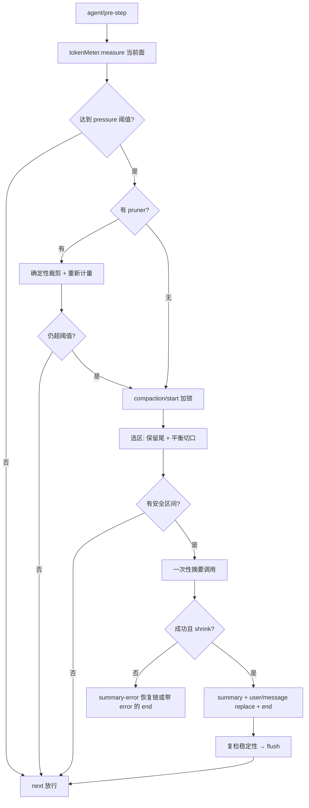

# 关键设计决策笔记：Cordis 事件系统 与 上下文压缩/Token 预算

> **【说明文档】** 本文是源码精读的衍生学习笔记，不属于 `docs/` 正式文档体系；事实以 [docs/cordis-primer.zh.md](docs/cordis-primer.zh.md)、[docs/subsystems/compaction.zh.md](docs/subsystems/compaction.zh.md)、[docs/subsystems/token-meter.zh.md](docs/subsystems/token-meter.zh.md) 与注释时的 `packages/compaction` 源码快照为准，冲突时以后者为准。
>
> 每条决策按"**决策 → 为什么 → 反方案被否的原因**"组织，编号 D1–D18 便于引用。

## 第一部分：事件系统（Cordis 事件驱动）

### D1 服务按 `ctx.<key>` 定位，不导入具体实现

- **决策**：插件实现 Service 并占据一个稳定 key（`ctx.llm`、`ctx.tools`、`ctx.sandbox`、`ctx.compaction`）；消费方只依赖 key 与类型，不 import 实现类。
- **为什么**：同一 seam 可换后端（compaction-basic 之外可有 tokenizer/模板兄弟后端）；加载、热替换、teardown 全部交给容器。
- **反方案被否**：直接 import 实现会把加载顺序、替换粒度、生命周期焊死，且无法做单进程多后端并存测试。

### D2 五种分发模式是事件公开约定的一部分

| 模式 | await | 顺序 | 有返回值 | harness 中的典型用途 |
|---|---|---|---|---|
| `emit` | 否 | 注册序观察 | 否 | `session/event` 后台持久化、`agent/status` 通知 |
| `waterfall` | 否 | 注册序环绕 | 是（可包装/短路） | `system-prompt/assemble`、`agent/pre-step`、`agent/request-error`、`compaction/summary-error` |
| `parallel` | 是 | 并行扇出 | 否 | 互不依赖的并行观察/清理 |
| `serial` | 是 | 注册序 | 是 | `agent/turn-stopping` 终止检查点 |
| `bail` | 否 | 停在首个 bail 值 | 是 | 首个处理器认领即止的分派 |

- **决策**：每个事件只能以其声明的模式分发，并在 JSDoc 用 `@mode` 标注；生成的目录把声明与调用点交叉校验。
- **为什么**：模式错配会产生静默语义错误（例如把需要短路的决策点写成 emit，守卫就永远拦不住）。把模式提升为类型/文档约定后，错误在文档生成期即暴露。

### D3 waterfall：环绕中间件 + 单决策事件的"权威短路"

- **决策**：监听器签名 `(payload, next)`。调用 `next()` 委托下游并可包装其返回值；**不调 `next()` 直接返回即短路**，是合法的终态决策。
- **为什么**：同一个事件点要同时容纳三类参与者——纯观察者（标注、记账，必须 next）、变换器（改写共享决策对象后 next）、权威决策者（安全守卫，直接返回 `reject`）。一条链表达全部。
- **实例**：`agent/pre-step` 默认决策是 `enter(messages)`；安全插件可短路为 `{kind:'reject'}`，压缩插件先压缩再 `enter`。规则明确："拥有决策权才短路，仅观察必须委托"。

### D4 类型化事件走声明合并，未知事件默认 required-on-read

- **决策**：服务通过 `declare module` 扩展事件映射表（如 `SessionEventMap`、`SessionProjectionRegistry`）；事件载荷在编译期全类型检查。会话日志里的未知事件类型默认**拒绝读取**，只有事件 envelope 带 `ignorable: true` 才允许跳过；结构性变更必须 bump `SESSION_FORMAT_VERSION`。
- **为什么**：旧版本重放新日志时，静默忽略一个它不懂的事件，可能导致模型可见输入缺漏。fail-loud 把"不懂"变成显式版本问题。

### D5 注册即效果，且必须可逆

- **决策**：提示词片段、工具、监听器一律经 `ctx.effect()`/`ctx.on()` 安装，注册返回 disposer；teardown 有顺序要求的工作放进同一个 effect。
- **为什么**：插件 reload/卸载是常态；没有自动撤销就会泄漏监听器与工具，产生"幽灵行为"。

### D6 加载顺序由 `inject` 依赖表达，不手写启动序列

- **决策**：插件声明所需服务，Cordis 等依赖就绪再 apply。
- **为什么**：N 个插件的启动序是偏序问题，手写编排随插件数组合爆炸；依赖声明让容器拓扑排序，且缺依赖在加载点 fail loud。

### D7（harness 特有）实时协调事件 与 持久会话事件严格分流

- **决策**：`agent/*` 大多是**实时协调信号**（队列通知、状态、拦截决策、流式帧），不进会话日志；对话/元数据事件走 `session/event` 成为 append-only 日志。唯一例外是 `agent/inbox/spliced`——它是持久事件，Inbox 队列状态靠它 fold 重建。
- **为什么**：日志的唯一使命是"可完整重放模型输入"。瞬态信号（一帧流文本、一次状态闪烁）进日志只会污染重放；而队列待办若不持久，崩溃后用户输入丢失。去留标准是一条硬不变量：**Model-visible ⟺ logged**。

## 第二部分：上下文压缩与 Token 预算控制

### D8 压缩是可选能力缝，不是 agent loop 主干

- **决策**：三角色拆分——Definition（`dsh-compaction`，抽象 `CompactionEngine` + 事件词汇）/ Provider（`dsh-compaction-basic`）/ Consumer（`command-compact`）。agent loop 只暴露 `agent/pre-step`、`agent/request-error` 两个拦截点，不含任何压缩策略。
- **为什么**：压缩策略（阈值、保留尾、摘要模型）演进快且可替换；焊进 loop 会迫使所有部署接受同一策略。
- **计价边界同样切开**：seam **不拥有计价 API**——单例 `ctx.tokenMeter` 拥有估算与回放 fold，basic 后端只拥有策略、事件排序与摘要调用。

### D9 三事件事务锁：start / summary / end，崩溃表现为"可检测的孤儿锁"

- **决策**：一次压缩 = 先 append `compaction/start`（获取耐久锁）→ 摘要 → `compaction/summary` + 相邻的 `user/message` replace → 最后 `compaction/end` 释放锁。`turn` 编号归属自动轮次，`null` 归属独立手动事务。
- **为什么把释放放在最后**：若操作中途崩溃，日志留下"有 start 无 end"的**可检测遗留锁**，而不是一个谎称完成的 end。活动的未匹配 start 阻塞所有入口；早于最近 `session/end-seed` 的未匹配 start 被识别为上一生命周期的陈旧证据而忽略。
- **锁是时间点标记，不是排他容器**：手动事务摘要等待期间，不相关的空闲注入允许出现在 start/end 之间；手动路径只复检"所选 span"，因此注入上下文在替换后仍保留。

### D10 摘要不新增 Surface 事件类型，复用 `user/message` + `surfaceOp: replace`

- **决策**：三个 `compaction/*` 事件都是 **log-only 元数据**（锁、摘要、遮蔽范围、token 账），**不**扩展 `SurfaceEventType`；摘要正文承载在一条普通 `user/message` 上，用 `surfaceOp:{op:'replace',startSeq,endSeq}` 把一个面位置区间替换成单个 checkpoint 节点。
- **为什么**：能到达模型的只有消息事件。复用 user 消息意味着投影、渲染、wire 全套管线零改动即可处理 checkpoint；被遮蔽的旧事件永不删除，审计与人类逐字稿仍可读全量历史。
- **位置而非数值区间**：`shadowedRange.start` 可能大于 `end`——早先 replace 落下的高 seq 摘要节点会出现在更老位置。权威集合是按**面顺序**排列的 `shadowedSeqs`。

### D11 双账计价：路由价决策，固定启发式记账（影子价格协议）

token-meter 为每个面节点同时给两个价：

| 价格 | 含义 | 用途 |
|---|---|---|
| `tokens` | 当前生效路由（provider/model）的真实定价：图片按路由声明的视觉 token 计，无声明则启发式 | 触发判断、保留尾选区、shrink 比较 |
| `heuristicTokens` | 与路由无关的固定启发式价 | 写进 `compaction/prune`、`summary` 的**影子价格** |

- **为什么要两本账**：replace 节点的记账事件与其替换事件同步相邻追加，纯消费方（O(1) 投影 fold）只需按影子价格扣减旧节点，不必为每个节点保存按路由浮动的单价。若记账也用路由价，路由一变，fold 的自洽性就破了。
- **锚点机制**：最近一次成功调用若与当前 canonical envelope 相同且 usage 不低于完整路由锚点（`baseline.kind='usage'`），则用"锚点 + 有符号 `surfaceDeltaTokens`"增量计价；否则（`estimated`）对完整信封重估。快照不可变，以 `logRevision` 标注消费到第几个持久事件。

### D12 切口必须落在工具调用/结果配对余额为 0 处

- **决策**：选区从尾部倒序划出保留尾后，切口向前回退到最近的平衡位置；Definition 导出 `toolPairingBalancedBefore/After(session, seq)`，并拒绝缺失 seq 与遗留 result。边界只保证配对完整，**不保证整个轮次完整**——超大轮次中较早关闭的 step 可以被压。
- **为什么**：模型 transcript 中 tool_call 与 tool result 必须成对且同序，切开配对会直接造成下一次请求非法。配对检查按当前 surface 成员关系做，陈旧 seq 立即报错。

### D13 两级缩减手段 × 两种触发原因

| | model-free 剪枝（`toolResultPruner`，可选） | 模型摘要压缩 |
|---|---|---|
| 成本 | 零模型调用，确定性 head/中/tail（Unicode 码点切分，不切代理对） | 一次 LLM 调用，凝练为 checkpoint |
| 配对 | 新 tool/result 保留同一 `callId` + 单节点 replace | 区间 replace 为单条摘要消息 |
| 触发 | 优先执行，执行后重新计量 | 剪枝后仍超阈值才执行 |

- **触发原因**：`pressure`（pre-step 预防性，按阈值）与 `context-overflow`（提供商已确认超长，可低于常规阈值强制一次有效平衡缩减，`retainTokens=0`）。
- **为什么先剪枝**：大量压力来自冗长工具输出，确定性裁剪即可消解，白付摘要调用不划算；pruner 是软依赖（`ctx.get` 而非 inject），缺失时 basic 独立可工作。
- **shrink 闸门**：摘要若不比原文短（按真实路由价比较）即判失败——纯文本 checkpoint 的启发式价等于路由价，比较口径无歧义。

### D14 两个事件介入点，恢复动作需要"客观推进证据"

- **pre-step（waterfall）**：压力压缩在请求推导**之前**运行；压缩后放行，driver 用新面派生请求。
- **request-error（waterfall）**：失败 step 关闭后运行；**只有 surface 的 `replaceGeneration` 前进过才返回 retry**——即使后续摘要阶段又抛错，已落库的 prune 成果也不浪费。取消永远优先于重试。
- **为什么看 generation 而不看"有没有报错"**：重试的正当性建立在"上下文确实变了，原请求值得重放"这一可观测事实上，而非后端的自我声明。retry 在开放 step 内重新 prepare，不重复 pre-step 与用户接纳、不耗重试预算。

### D15 稳定性协议：摘要跨异步窗口，提交前复检

- **决策**：两种稳定级——自动（turn 内）要求 `whole-surface` 整体不变；手动（turn 间隙）只要求 `selected-span` 不变，允许期间有新输入 append。摘要返回后、提交前各复检一次。失败分类含 `changed`（span 已变）。
- **为什么**：摘要是异步模型调用，返回时面可能已被其他写入改变；用旧面的摘要替换新面会丢消息。复检把"选择依据过期"变成显式失败而非数据损坏。

### D16 手动路径：maintenance 闸 + 独立括号 + flush 后才放行排队提示

- **决策**：`compactNow()` 同步进入 agent idle maintenance（后续唤醒输入 FIFO 等待），写 `turn:null` 的独立 start/end，闭合后 **flush 耐久检查点**，之后排队 prompt 才允许从新表层派生。错误码固定为 `busy/cancelled/changed/summary/commit/persistence`。
- **为什么**：手动压缩是用户显式命令，返回成功就必须已落盘（否则"成功"是谎言）；两道串行化缺一不可——进程内靠 maintenance/turn 闸，跨重启靠日志里的 start 标记。

### D17 摘要请求必须可由日志重建，且刻意做成 KV-cache 友好

- **决策**：`compaction/summary` 记录摘要块、完整 `rawOutput`（经 `llmStreamCall:true` 标记的一次性调用必须提供）、usage 与 envelope（provider/model/maxTokens）、遮蔽范围与 token 账。请求构造复刻真实会话前缀（system + header 工具 schema + 区间消息），摘要指令只作为最后一条 user 消息追加，不另起 summarizer system prompt。
- **为什么**：前缀与上次真实路由请求一致，可命中提供商 prefix cache，降低摘要成本；落库字段保证这次一次性模型调用事后可完整重放（Model-visible ⟺ logged 对压缩自身同样成立）。max-tokens 截断直接判失败——残缺检查点会成为后续对话的唯一记忆，比不压缩更危险。

### D18 图片省略走纯消息投影，而非 surface replace

- **决策**：`image/offload` 事件保留节点与消息身份，只声明"某 seq 节点内深度优先第 N 张图片永久省略"；浏览器端无 Cordis 的纯投影函数据此不可变地重写消息。下标对全部图片（含已省略）连续计数，严格递增并在重放时机械校验。
- **为什么**：图片容量溢出只需遮蔽块内局部内容，替换整个消息节点代价过大且会丢同条消息的文本；纯投影是无 Node 依赖的纯函数，活体与 detached replay 共用一份定义。

## 第三部分：Token 预算公式链（basic 后端）

配置解析在加载点一次完成（未知键拒绝、域校验、深冻结），运行期无 `?? 默认`。代入当前路由的 `contextWindow` 后：

```text
messageBudgetTokens = contextWindow - reservedCompletionTokens
pressureBudgetTokens = messageBudgetTokens - messageBudgetTokens * pressureHeadroomRatio
thresholdTokens     = min(contextWindow * thresholdRatio, pressureBudgetTokens)
retainTokens        = contextWindow * retainRatio  （或显式 retainTokens）
```

- 每层余量 ≤ 0 都 fail loud；`retainTokens >= thresholdTokens` 同样报错——否则触发时整个窗口都在保留区，永远选不出可压区间，策略静默失效。
- 选区：倒序累计节点路由价划出保留尾 → 回退到工具配对平衡切口 → system 头永不入区；选不出安全区间返回 `null`，不写任何事件。

预算判定流程：



## 第四部分：两个系统的交叉映射

压缩是"事件驱动架构"最集中的示范场：

| 压缩需求 | 选用的事件机制 | 体现的决策 |
|---|---|---|
| 压力时在请求前介入 | `agent/pre-step` waterfall 短路/放行 | D3 权威决策 |
| 溢出后重试 | `agent/request-error` waterfall + generation 证据 | D3、D14 |
| 摘要失败的可扩展恢复 | `compaction/summary-error` waterfall（返回 true 重新选区计价） | D3 |
| 压缩事务持久化与计价 fold | `session/event` emit 订阅 + log-only 事件 | D7、D11 |
| 阻止并发压缩/跨重启互斥 | 日志中的 start/end 标记，而非进程内锁 | D9 |
| turn 边界终止检查 | `agent/turn-stopping` serial | D2 |
| 图片省略重放 | 纯 `SessionMessageProjection`，非事件拦截 | D18 |

## 一句话总括

事件系统的决策内核是"**按协作语义选模式、按可重放性决定是否入日志、注册可逆、类型即约定**"；压缩子系统的决策内核是"**策略外挂为可选 seam、事务状态全部耐久化、面替换不改历史、双账计价让 O(1) fold 自洽、一切异步改写提交前复检**"——两者共同服务于同一条最高约束：**模型看到的一切都必须能仅从 append-only 日志重建**。
