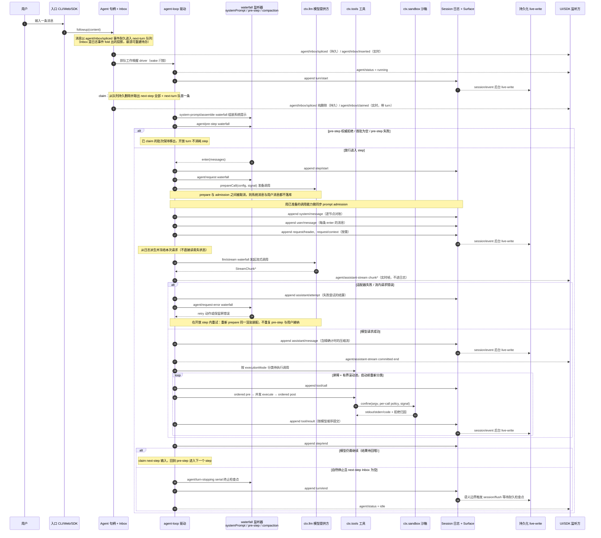
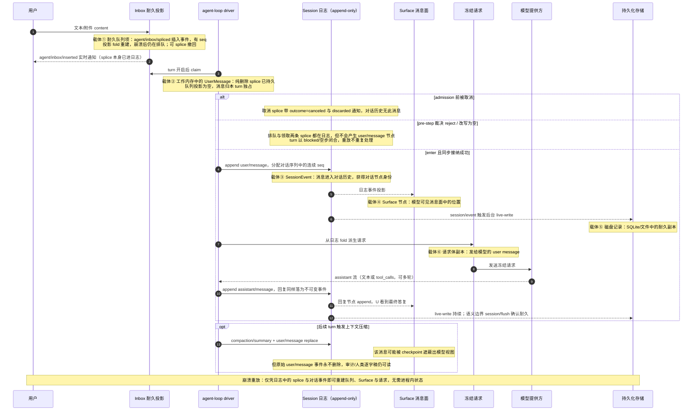
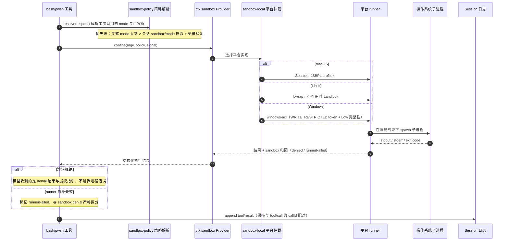
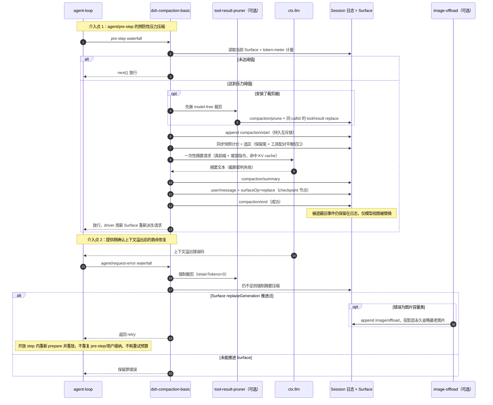

# 一条用户消息的完整执行链路

> **【说明文档】** 本文是四组核心包（agent / session / sandbox / compaction）源码精读注释工作的衍生总结材料，仅供学习参考，不属于 `docs/` 正式文档体系；表述以注释时的源码快照为准，与仓库现行文档冲突时以后者为准。
>
> 本文基于 `packages/core/agent`、`packages/core/session`、`packages/sandbox`、`packages/compaction`
> 四组包的源码精读注释，以及 [docs/agent-lifecycle.md](docs/agent-lifecycle.md) 的权威生命周期事实整理。
> 追踪场景：用户在 CLI / Web / SDK 中输入一条普通消息，Agent 经过一次或多次模型调用与工具执行后给出最终回复。
>
> 视频讲解[DeepSeek Harness 源码解析](https://weixin.qq.com/sph/AHNynpGamU)

## 一、全景分层

| 层 | 归属包 | 职责 |
|---|---|---|
| 入口层 | CLI / Web / SDK（`apps/*`、`packages/interaction`） | 接收用户输入，调用 Agent 句柄的 `followup()` |
| 协调层 | `dsh-agent`（句柄/Inbox/注册表）、`dsh-agent-loop`（wake driver / turn / step） | 排队、唤醒、串行化 turn、驱动 step 循环 |
| 守卫层 | waterfall 监听器（`dsh-system-prompt`、`dsh-compaction-basic` 等） | `system-prompt/assemble`、`agent/pre-step`、`agent/request`、`agent/request-error` 拦截决策 |
| 能力层 | `dsh-llm`、`dsh-tools`、`dsh-sandbox` | 模型调用、工具派发、命令隔离执行 |
| 真相层 | `dsh-session` | append-only 事件日志 + Surface 消息面投影 |
| 耐久层 | `dsh-session-persistence` / checkpoint policy | 订阅 `session/event` 后台落盘，`session/flush` 提供耐久屏障 |

核心原则：**会话日志（session log）是唯一真相源；一切模型可见输入都必须可从日志重构（Model-visible ⟺ logged）**。多数 `agent/*` 事件是实时协调信号（状态、拦截、流式帧，不进日志）；例外是 `agent/inbox/spliced`——它是持久会话事件，Inbox 队列状态靠它重放。对话内容（`user/message` 等）则在 admission 时才进入日志。

## 二、主成功路径时序图

### 2.1 消息本体视角：单条消息的载体变迁

上图以组件为泳道，本图改为追踪**同一条用户消息本身**：它依次以六种载体存在，前两种是"待办"形态，admission 后才进入对话历史。

载体变迁要点：

| 阶段 | 载体 | 持久形式 | 关键属性 |
|---|---|---|---|
| 入队 | next-turn / next-step 队列项 | `agent/inbox/spliced` 插入事件 | 投影 fold 重建，崩溃仍在排队，可撤回 |
| claim | driver 工作内存中的消息 | 纯删除 splice 事件（无 canceled） | 独占归属本 turn，reject 也不退回 |
| 接纳 | `user/message` SessionEvent | 不可变对话事件 | 进入对话历史，连续 seq，Surface 可见 |
| 投影 | Surface 节点 | 派生自日志 | 模型视图位置，可被 replace 遮蔽 |
| 落盘 | 磁盘记录 | 存储层记录 | 后台 live-write，flush 前不保证耐久 |
| 请求 | 请求体 user message | 派生自日志 | 每次请求从日志 fold，非内存直读 |

## 三、分阶段说明

### 阶段 A：入口与收件箱（耐久排队）

1. `followup(content)` 经统一入口 `send(msg, 'next-turn', wakeup)` 追加一条持久的 `agent/inbox/spliced` 事件进入 **next-turn** 队列，并实时发出 `agent/inbox/inserted` 通知 UI。Inbox 是 session projection：两个队列（`next-turn` / `next-step`）的状态全部由 splice 事件 fold 重建，进程崩溃后待处理输入不丢。
2. 入队动作置位 `wakeRequested` 闩锁并唤醒 driver；driver 是单消费者，保证同一 Agent 的 turn 串行。`steer()` 入 next-step 队列（当前 turn 的下个 step 即消费），`followup()` 入 next-turn（必须开新 turn）。

### 阶段 B：turn 开启与 claim（认领接管）

3. driver 追加持久事件 `turn/start`，随后在 pre-step 开头执行 **claim**：取出 next-step 队列全部消息，轮次首步再取 next-turn 队首一条。claim 落一条"纯删除"splice（`removedCount>0、inserted=[]`，无 canceled 标记）并逐消息发出实时的 `agent/inbox/claimed {message, turn}`。
4. **接受/拒绝由随后的 `agent/pre-step` waterfall 裁决**：默认决策 `enter`（消息获准进入对话，随后 admission 为 `user/message`）；守卫可返回 `reject`（不开 step、不调模型，turn 以 `blocked` 闭合）或把消息改写为空（turn 正常开闭但零模型调用）。
5. **claim 不可逆**：消息已从持久队列移出，被 reject 也不会退回——它留下"排队 splice → 领取 splice"的耐久痕迹，但不会成为对话历史中的 `user/message`，重放不会重复处理。"用户主动取消"走另一条路径：splice 带 `outcome:'canceled'` 并发 `agent/inbox/discarded`，与 claim 的接管语义区分。

### 阶段 C：pre-step 守卫（压缩在此介入）

6. `system-prompt/assemble` waterfall 组装系统提示；`agent/pre-step` waterfall 让各监听器给出**权威决策**：放行 `enter(messages)`、拒绝 `reject`、或替换/注入消息。
7. `dsh-compaction-basic` 在 pre-step 上做压力检查（详见第五节）。

### 阶段 D：请求准备与同步接纳（admission）

8. `step/start` 与 `agent/request` 之后，driver 先 `prepareCall()` 取得调用能力，再执行**同步原子接纳**：`system/message`（逐节点对账 reconciliation）、每条 enter 消息的 `user/message`、以及按需的 `request/header` 与 `request/context`。消息只有到这一步才从"耐久待办"变为对话历史中的可见节点。
9. 接纳语义：prepare 与 admission 两个异步阶段之间若被取消，系统消息与用户消息**都不落库**；一旦接纳，模型可见内容全部已持久化，满足可重放。
10. driver 随后**从日志而非内存状态**派生并冻结请求对象。

### 阶段 E：流式模型调用

11. `llm/stream` waterfall 发起调用；实时 chunk 只经 `agent/assistant-stream` 推送（瞬态、不进日志）。
12. 成功结算为持久的 `assistant/message`（即使内容为空或 max-tokens 结束也记录，并内嵌精确计时流）；失败到结算点记为 `assistant/attempt`。

### 阶段 F：工具派发与沙箱执行

13. driver 按工具声明的 `executionMode` 分类：exclusive 走独占屏障，parallel 走有界滚动池；并发执行、**按模型顺序**经 ordered post 提交 `tool/result`。
14. 命令类工具不自行 spawn，而是调用 `ctx.sandbox.confine(argv, policy, signal)`，由沙箱 seam 解析到平台 runner（详见第四节）。

### 阶段 G：step 循环与 turn 结束

15. 每个 step 以 `step/end` 收口；若模型还要基于工具结果继续，driver claim next-step 输入后回到 pre-step，形成多 step 循环。
16. 自然停止时先跑 serial 的 `agent/turn-stopping` 终止检查点，再追加 `turn/end`（结局含 completed / blocked / aborted / error），状态回到 idle。

### 阶段 H：耐久化

17. append 热路径不等 I/O：持久化插件订阅 `session/event` 做后台 live-write。
18. `session/flush` 是耐久与错误观察屏障，由 checkpoint policy 在语义边界（如 turn 结束、手动压缩闭合）触发；flush 返回后，此前事件确认落盘。

## 四、横切链路一：命令工具的沙箱执行

要点：策略（policy）与强制（enforcement）分离；默认 **fail-closed**，无法建立隔离时不放生子进程；Windows 方案中工作区能力 SID 的授权常驻复用，每会话私有 temp 的授权用后即撤。

## 五、横切链路二：上下文压缩的两个介入点

要点：

- 压缩事务 = `compaction/start`（锁）→ `compaction/summary`（计量与摘要）→ 相邻的一条 `user/message` replace（checkpoint）→ `compaction/end`；任何失败都补一条带 error 的 end。
- 切口必须落在工具调用配对余额为 0 处，替换后每个 tool-call 仍有配对结果，模型 transcript 始终合法。
- 影子价格协议：计量事件与替换事件同步相邻追加，纯消费方无需保留逐节点 token 单价。

## 六、事件分类速查

| 类别 | 事件 | 是否进日志 | 用途 |
|---|---|---|---|
| 持久会话事件 | `turn/start`、`turn/end`、`step/start`、`step/end` | 是 | turn/step 生命周期、重放 |
| 持久会话事件 | `user/message`、`system/message`、`assistant/message`、`assistant/attempt` | 是 | 对话内容与失败尝试结算 |
| 持久会话事件 | `tool/call`、`tool/result` | 是 | 工具配对与执行结果 |
| 持久会话事件 | `request/header`、`request/context` | 是 | 重构冻结请求 |
| 持久会话事件 | `agent/inbox/spliced` | 是（Inbox 投影事件） | 待办队列的插入/领取/取消，重建排队状态 |
| 持久 log-only 事件 | `compaction/start\|summary\|end\|prune`、`image/offload`、`sandbox/mode` | 是（不带 surfaceOp） | 事务、决策、模式的可重放元数据 |
| 实时协调事件 | `agent/inbox/inserted`、`agent/inbox/claimed`、`agent/inbox/discarded`、`agent/status` | 否 | 队列变更 UI 通知与状态 |
| 实时协调事件 | `agent/pre-step`、`agent/request`、`agent/request-error`、`agent/turn-stopping` | 否 | 拦截、组装、错误恢复、终止检查 |
| 实时流事件 | `agent/assistant-stream` | 否 | 瞬态流式帧，重放读持久结算 |

## 七、关键不变量小结

1. **队列耐久，对话权威**：消息先以 `agent/inbox/spliced` 耐久排队（崩溃不丢待办），claim 是持久的"领取删除"，只有通过 `enter` 并同步 admission 后才成为对话历史中的 `user/message`；被 reject 的消息有排队与领取痕迹但无对话节点。
2. **接纳原子性**：system/user/header/context 要么一起落库，要么因取消全部不落。
3. **从日志派生请求**：冻结请求只读日志与 Surface，崩溃后可完全重放同一次模型输入。
4. **Surface 替换不改历史**：compaction/prune/offload 只改变模型视图或投影，原始事件永不删除。
5. **工具配对平衡**：压缩切口与结果提交都保证 call/result 配对完整、顺序与模型序一致。
6. **沙箱 fail-closed**：隔离建立失败即中止，拒绝与 runner 故障分类归因。
7. **两层串行化**：进程内由 maintenance/turn 闸保证，跨进程/跨重启由日志中的 `compaction/start` 标记保证。
